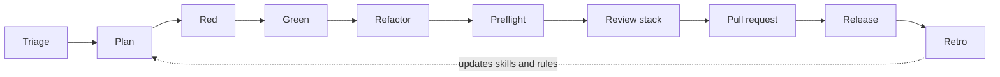

# Agentic engineering at PlannerPal

How we build software with AI coding agents.

PlannerPal turns an adviser's meeting into notes, documents and CRM updates, in a regulated industry, for real customers, with a small team. Agents write most of our code. The bar is the same whoever wrote it.

This document is for our engineers, for people thinking about joining, and for anyone who wants to see how a small team runs agents without lowering its standards. It describes what we do today, drawn from our repos' rules and skills, our pull request threads, our call transcripts and our Slack. Where a practice is aspirational, or where we fall short of it, we say so. There is a section for that at the end.

The tooling we name is what we use now: Cursor, Claude Code, Codex, Bugbot, CodeRabbit, Aikido, Trivy, GitHub Actions, Jenkins. None of the practices depend on a particular tool.

## Contents

- [Principles](#principles)
- [The loop](#the-loop)
- [Before you write code](#before-you-write-code)
- [Test-driven development with an agent](#test-driven-development-with-an-agent)
- [Several pieces of work at once](#several-pieces-of-work-at-once)
- [Definition of done](#definition-of-done)
- [The review stack](#the-review-stack)
- [Releases](#releases)
- [Security and data boundaries](#security-and-data-boundaries)
- [Git and pull requests](#git-and-pull-requests)
- [How agents are steered](#how-agents-are-steered)
- [The learning loop](#the-learning-loop)
- [Autonomous agents](#autonomous-agents)
- [Levels](#levels)
- [What we look for when hiring](#what-we-look-for-when-hiring)
- [Anti-patterns](#anti-patterns)
- [Where we are not yet](#where-we-are-not-yet)
- [Reading](#reading)

## Principles

1. **The bar does not move.** An agent-written change is held to the same tests, review and security standard as a hand-written one. "The agent did it" is never a reason.
2. **The engineer is accountable for every change, and proves it with evidence rather than by reading every line.** Tests that fail on the old behaviour, a reproduction on `main` and on the branch, a screenshot or video of the real product, the bots' findings answered, the blast radius named. Someone who still has to read every line of agent output is not using agents enough. Someone who cannot explain what a change does and why is not ready to merge it.
3. **Throughput comes from carrying several pieces of work at once,** not from typing faster or prompting harder. One stream with an agent is no faster than one stream without. Agent runtime is your idle time; fill it.
4. **Tests are how an agent proves its work.** A failing test first, then the smallest code that passes it. A test that stubs the thing under test, or that locks in the wrong behaviour to go green, is rejected in review.
5. **Deterministic tools before models.** Lint, type-check, tests and scanners run before a model reviews anything. They are faster and they do not hallucinate.
6. **Assume the output can be wrong, and check it.** Bots are bug catchers, not reviewers. Models from different vendors have different blind spots. A green check is not proof that the relevant test ran.
7. **Rules and skills are versioned like code.** What an agent is told lives in the repo, is reviewed in pull requests, and is updated from retros. A rule that must stick goes in a file every agent reads, not in a chat.
8. **Production, customer data and production credentials are off limits to agents.** Fixtures, fakes, seed data and read-only restores instead.
9. **Small diffs, one task per branch, one pull request per task.** Match the patterns already in the repo. Do not refactor quirks you were not asked to touch. Call out hidden scope before you start.

## The loop

Every change goes round this loop. The release step is the one most teams leave out and the one that has done most for us.



| Step | What happens | Who decides |
|------|--------------|-------------|
| Triage | Rule feature flags in or out. Find every caller of anything shared you are about to change. Call out hidden scope. | Engineer, with agent |
| Plan | Agree what is being built and what is not. One question at a time. Size it. Explore the code rather than ask. | Engineer and agent, then human sign-off |
| Red | Write or change one test so it fails for the right reason. | Agent writes, human approves the test |
| Green | Smallest code that passes. No speculation. | Agent |
| Refactor | Clean up with the test green. Never while red. | Agent, engineer checks |
| Preflight | Lint, type-check, tests for every stack touched. Confirm the tests you wrote actually run in CI. | Agent runs, engineer reads |
| Review stack | Tools, then Bugbot, then a security review, then blast radius. Then wait for the hosted bots on the pushed head. | Agent orchestrates, engineer owns |
| Pull request | Small, one task, evidence attached. Threads answered. | Engineer |
| Release | Agent review of the whole `main` to `production` diff, smoke test on staging, severity triage of anything the bots raise. | Release pair |
| Retro | What went well, what went wrong, which rule, skill, script or check to change. | Engineer picks, agent applies |

## Before you write code

### Rule the flags in or out

When something "doesn't work" or a screen is missing, the first ten minutes go on feature flags, not on the code path. Our product flags are booleans resolved at login. Find the gate in code, check the stored value, re-login, and write down the verdict: flag explains it, or flags ruled out. This rule exists because we once lost most of a day debugging a code path that was fine; the flag was off.

### Find every caller

Before changing a method that other screens or services already call, search every repo in the workspace, not just the file you are editing. Report the callers. If the default contract stays what callers get today, carry on. If any existing caller would see a different result, status or side effect, stop and ask. When the response shape changes, the paired pull request in the calling repo is opened alongside and they deploy together.

Auth, feature flags, API contracts and shared state carry a must-read gate before anything is changed. Cross-service paths get the same treatment: a write that bypasses the hooks in the owning service is a bug in whichever repo made it, and the fix belongs in the owning repo.

### Call out scope

A ticket that says "just a small piece of work" and turns out to contain a new auth flow and a backend feature that does not exist is the most expensive thing we deal with. Before starting, read what is actually being asked. If the scope is bigger than the ticket, say so, in writing, before any code. A design generated by an agent is not a ticket; the ticket has to say what the system does. Large tickets become projects with one ticket per deliverable, so anyone can see what has and has not landed.

### Grill the plan

For anything non-trivial, the agent interviews you about the plan before writing a diff. One question at a time. If a question can be answered by exploring the codebase, the agent explores instead of asking. The aim is a shared understanding of each branch of the decision tree: what is in, what is out, what we are not sure about. Large diffs do not start without that. For risky work, have a second agent review the plan before build starts.

A running reference beats a written spec. If there is a deployed prototype or a working screen, point the agent at the URL and tell it that is the source of truth.

### Spike or TDD

Pick the mode before writing code, and do not mix them in one task.

- **Known problem:** strict TDD. No production code without a failing test first.
- **Unknown problem:** spike first. Write the spike findings document before the code. Spike code lives in a quarantined folder, has no tests, and is not promoted. When the spike has answered the question, the real change is rewritten through TDD. When a spike artefact does end up landing, it gets a follow-up ticket to generalise it.

If in doubt, spike first.

### Size it

Before starting, say how big each piece of work is and which pieces will ship in the time you have. T-shirt sizes are enough. The target slice for one agent is half a day. A plan at the end of the session is a miss; working software, however small, is the point. This is also how we tell whether an engineer can judge difficulty, which matters more with agents, not less.

### Ask the agent for the test scenarios

Before deleting or changing something you do not fully understand, ask the agent: when is this called, and how would we confirm it still works if we removed it? The answer is a list of test scenarios. Write those first.

## Test-driven development with an agent

### The cycle

```
RED      Write one test for the next behaviour. Run it. It fails for the right reason.
GREEN    Write the minimal code to pass. Run it. It passes.
REFACTOR Clean up with everything green. Run again.
```

One test at a time. Do not write all the tests and then all the implementation; that is horizontal slicing and it hides design problems until the end. Work in vertical slices, tracer bullets through the whole stack, so there is always a thin working path.

### Halt after red

In our newer codebase the agent stops after writing the red test and waits for a human to approve it before writing any production code. The test is the specification. It is cheap to reject a bad test and expensive to reject the code written to satisfy it. This is an always-on rule, not a skill the agent can skip.

### Prefer turning an existing test red

When changing behaviour, change an existing test so it fails. Add a new test only when no current case would fail. This keeps the suite describing the system rather than accumulating one test per prompt.

### What counts as a test

A test earns its place if it would fail when the code is wrong. We check five things:

1. **It tests behaviour through a public interface,** not implementation detail.
2. **It mocks only at system boundaries:** network, clock, storage, third-party APIs. Never your own classes or modules, and never the thing the test claims to verify. That is a tautology, not a test.
3. **It would fail under mutation.** If you flip the condition, does it go red? For a bug fix: with the guard removed, does the test fail?
4. **It is readable by a human and an agent.** `// Arrange`, `// Act`, `// Assert` comments make a test scannable for both.
5. **It does not test the framework.** No tests that a component mounts, that a schema introspects, that a class list is present, or that an ORM default applies.

Two more that come from review threads:

- **It does not lock in the wrong behaviour.** A test that pins what the code does today, when what it does today is the bug, is rejected. So is a guard added to make a bot happy when a stronger invariant already exists in the same file.
- **It actually runs in CI.** We have had green checks on specs that were never executed because a test glob was unquoted and the shell expanded it one level deep. When you add a test, confirm the CI job ran it, by name.

Backend query behaviour is tested against an in-memory or containerised database. A unit test that stubs the collection or the query builder checks only the shape of the query, not whether it returns the right rows. Trust-boundary tests use attacker fixtures: an attacker-owned group, a victim target, and an assertion that the victim's rows are unchanged.

End-to-end tests behave like a human, in a browser. "End to end" means browser; a pipeline or unit test is not called that. A passing end-to-end suite should mean the product works for a person, not that the test could find its selectors.

### Coverage

We measure line coverage per repo and track it over time. Floors are set per branch in CI so a pull request cannot lower them. We do not gate releases on a percentage yet; the numbers range from the thirties to the seventies across repos and we need them stable first. Pull requests do not collect coverage, the integration branch does. A review flags deleted coverage and spy-only tests.

## Several pieces of work at once

This is the practice that most changes how we work, and the one we hire for.

### Why

An agent working on one task leaves you idle for minutes at a time. The backlog has many small things in it. The way to turn agent speed into team speed is to run several pieces of work alongside each other and spend your time reading results, not watching cursors. On a normal day one of us has seven to ten agent sessions open; on a heavy day, dozens.

### How

**One branch per task, one pull request per task.** Never let two tasks share a branch. For a large feature, stack small pull requests into a feature branch behind a flag, then collapse the feature branch into the integration branch once it is whole.

**Isolate each agent.** A git worktree, a second clone, a container, or a cloud agent on its own VM. The mechanism does not matter. What matters is that no agent is editing in a folder where you are switching branches, and no two agents share a working copy. If two agents must share a checkout, the brief names exactly which files each may touch, and an agent that needs a third file stops and says so.

**Never `git stash` in a repo with several worktrees.** The stash is shared across them and you will pop someone else's work. To test against old code, swap the file in with `git show <base>:<file> > <file>` and copy it back after.

**Pin the checkout.** An investigation or audit names one path and one commit. A sibling checkout that is fifty commits behind will give you a confident wrong answer.

**Plan for collisions before you start.** Three tasks that each add a route will collide in the routing file. Two tasks that each add a migration will collide on the migration number. Two agents on one machine will collide on ports and on the dev database. Decide the merge order up front, run the shared-resource tasks in sequence, and renumber migrations rather than writing merge migrations.

**Split the work so the reviewers can see it.** A ten-thousand-line branch is unreviewable by a human and the bots' context runs out before the end of it. One of us used an agent to regroup such a branch into task-sized pull requests, ran the review stack on each, and merged them in order. The bots' comments became useful again the moment the diffs were small.

**Keep a side quest.** Alongside the set work, each engineer has a backlog of small background tasks: consolidating components, lifting coverage on a file, clearing a lint class. While the main deliverable is waiting on a bot loop, an agent picks one off and raises a small pull request. Not all at once; one at a time, every day.

**Read every result before merging it.** Each diff gets read for what matters: the data boundary, the auth path, the contract with callers, anything the agent chose that you did not ask for. Each result gets checked in the browser or by its tests, independently of the others, and each agent hands back a screenshot so you can check several in the time it takes to click through one. If you cannot say what a particular agent changed, it does not merge.

**One base at a time.** When the same fix has to land on two bases, an integration branch and `main` for example, finish one first. Get that pull request green on CI and every bot with every thread resolved, then port the final diff. Opening both together means every review round is done twice.

**Stop an agent that does something unfit.** The things that have earned an immediate stop: writing personal data into a payload that does not need it, bypassing the module that owns a kind of write, deleting rows to tidy up, changing CORS or a port to make a local setup work, and quietly widening the scope of the task. The agent is fast; your judgement is the control.

### Parent and children

The shape that works for us on anything with more than one moving part:

- **Explorers** are read-only. Each gets a question, a thoroughness level, and a path to pin to. It returns a structured report with file paths and line ranges. It edits nothing.
- **Implementers** each get a worktree, a branch, the repo's `AGENTS.md` to read first, the files they own, and the instruction not to commit, not to push, and not to read any secrets file.
- **The parent** integrates, runs the review stack, opens the pull request, waits for the hosted bots, and answers the threads.

Children do not commit. A child that opens a pull request on its own initiative has done the wrong thing.

### What good looks like

Three or more tasks working, each on its own pull request, run alongside each other, each result verified before it merged, collisions in the shared file resolved by hand, tests green on the integration branch afterwards.

Five agents, five pull requests, none of them understood and two of them broken is a worse outcome than two tasks done properly. Volume without reading is not throughput.

## Definition of done

Green CI is the floor, not the definition.

- **Preflight before you say done.** Lint, type-check and the relevant tests for every stack you touched. Use affected-project tooling where the repo has it. Regenerate anything generated: GraphQL types, sync schemas.
- **Confirm the tests ran.** Find your new spec in the CI log by name. A green job that skipped it is a red job.
- **Smallest relevant target first.** Run the one test file, then the package, then the suite only if you need independent confirmation of something CI has already shown.
- **Run checks sequentially,** not concurrently. Lint, then build, then test. Parallel runs on a shared or constrained host produce timeouts that look like failures.
- **Cap the run.** On a constrained host set a timeout, cap the Node heap, cap workers, and limit CPU affinity. If a required check cannot run safely under those caps, report the CI result and the local limitation. Do not retry without limits.
- **Check for leftovers.** After an interrupted or timed-out run, look for orphaned test or compiler processes.
- **Scanner clean** before a pull request in any repo that scans, with the exceptions described under Dependencies.
- **Documentation goes to its home.** Living behaviour is a specification. A choice is a thin decision record, under eighty lines, with no implementation steps in it. An unknown is a spike document. A build sequence is an editor plan and is not committed to the docs folder.

### Show it working

Green tests say the code does what the test says. They do not say the feature works for a person. For anything a user can see, the proof is the running product. For anything a user cannot see, the proof is still something a reviewer can watch.

- **Reproduce before you fix.** A bug-fix pull request shows the bug happening on `main` and not happening on the branch: the same steps, two outcomes, screenshots or a recording of each. If four pull requests share one fix, one of them carries the evidence and the others point at it.
- **Screenshots per task.** When several agents are running, each one ends its task with a screenshot of the result in the real local UI. That is how you check five results in the time it would take to click through one, and how you catch the agent that reported done on something that renders blank.
- **A video on the pull request.** Any change with visible behaviour gets a short recording of the real local app doing the thing, attached to the pull request description. Reviewers watch it before they read the diff, and will not start without it. It is attached, not committed. Backend-only changes record the test run or the API responses on synthetic data instead.
- **A second video from staging, on the ticket.** Once the change is deployed to staging, the engineer records it working there and attaches that to the ticket. Until that exists the ticket is still in development.
- **Root cause and fix, written on the ticket.** One paragraph each, in plain language, so the person retesting knows what to retest.
- **Say what you verified and what you only read.** "This is from reading the code; nothing was run against a live system" is a legitimate finding. Presenting it as a tested one is not.
- **Agents take the screenshot, not you.** The agent has a browser. Ask for the screenshot as part of the task, and read it as part of reading the result.
- **No mock-ups as evidence.** A screenshot of a storybook, a design file or a hand-edited DOM is not proof. The product, running, with real seed data.

A pull request that says "tested locally" with nothing attached has not been tested locally as far as the reviewer can tell. When the local environment is broken and the work shipped on tests alone, the pull request says so and asks for a tester.

## The review stack

Every pull request goes through the same stack in the same order, in both of our main codebases. An agent orchestrates it; the engineer owns the result. The first four steps run before `gh pr create`. The fifth runs after.

### 1. Tools

Lint, type-check, unit tests for the touched packages, the dependency scanner where configured, a secrets scan where the diff touches hooks or anything secrets-adjacent. These are deterministic and run first. The review output names each tool and whether it ran: `pytest pass, 74` or `gitleaks skipped, CLI not installed`. A tool that did not run is not a tool that passed.

### 2. Bugbot

One Bugbot pass over the branch diff, against the right base. When authoring a pull request, fix the Critical and High findings yourself and run it again. Three passes is the target; on a large diff the loop can run for days, and the fix for that is a smaller diff, not a longer loop. Bugbot is skipped only when the diff is docs, skills or editor rules alone, and then the report says `skipped — <reason>`. Findings are never invented to fill the section.

Bugbot catches bugs. It does not review design. Its best classes in our threads: logic defects, races between concurrent jobs, validation that is weaker on the new path than the old, authorisation drift, jobs left non-terminal, swallowed errors, missing owner checks, path parameters never interpolated, decryption skipped.

### 3. Security review

An OWASP walk: the web Top 10, and the LLM Top 10 when the diff touches prompts, model calls or anything that feeds a model. Think like an attacker. Prefer a failing test to a lecture. Never write exploit payloads or step-by-step abuse into the review.

One class gets its own line: ordinary-use wrong writes. A signed-in user does the normal thing and the write lands on the wrong person, tenant or session. It is not an injection and it is not an access-control bypass in the usual sense, and it is the one that hurts us most in a regulated product. The humans catch these more often than the bots do, along with self-fulfilling checks, where a mutable field is compared with itself and the write proceeds because all four copies of the wrong value agree.

### 4. Blast radius

What else could this change touch: API routes, events, database schema, shared types, configuration, feature flags, other services' hooks. Does the diff size match the stated goal? Do the tests prove public behaviour or spy on internals? Was any coverage deleted? Is there a detour in the commit log, a CORS change or a sign-in experiment, that was later removed and should not be there at all?

### 5. Wait for the hosted bots

Pushing is not done. After the push, the agent polls until Bugbot and CodeRabbit have both reviewed the current head, and every new thread is answered. The hosted bots post minutes after the push; an agent that replies to the existing threads and ends its turn will miss them. A new push restarts the wait. This rule exists because we spent a week telling agents to wait in chat, and chat does not stick.

### Answering a finding

Not every finding is fixed. Each one gets one of four answers, written on the thread:

- **Fixed,** with the commit.
- **False positive,** with the data-flow proof: this value comes from `argv`, not a request; this helper never reads the path it is handed.
- **Pre-existing,** with a ticket. The line is byte-identical to the target branch and the fix is tracked separately.
- **Declined,** with the reason. A stronger invariant already exists in the same file; the alias was removed on purpose so the caller fails loudly.

A disputed finding is left open with the explanation, not resolved, so the human reviewer sees both sides. When the bot diffed against the wrong base, say so and point at the right one.

### More than one model

Bugbot clears the diff. For the final review we use a model from a different vendor, because two models from one vendor share blind spots. A second-vendor skim of one fix found the same race in three sibling call sites that the bot had cleared, because the bot looks at the diff and not at its neighbours. On high-risk batches, a port of an integration or a security fix across services, we run three vendors and compare. One overnight run found ten real bugs the others had not.

The cost of this is reconciliation. Three reviewers disagree, and the engineer spends time working out which is right. That time is real and it is still cheaper than the bugs.

### On the pull request

CI, Bugbot, CodeRabbit and Aikido run on every pull request. A merge needs every required check green and every conversation resolved. Human approval is set per branch; see Git and pull requests. Paths that carry cross-tenant risk have code owners, so a human who knows the risk reviews them. A substantive push after approval dismisses the approval and needs a fresh one.

A review comment on GitHub or the ticket is followed by a message in Slack. We assume nobody sees the comment otherwise.

## Releases

Release is where most of our quality problems used to show up, and where the single most effective change we made sits.

### The agent reads the whole release

Before July, releases regularly introduced bugs. In July we made one step mandatory: before a release goes out, an agent reviews the full diff between `main` and `production` for every service in the release. Not the individual pull requests, which had each been reviewed, but the combined change that is about to ship. Release-introduced bugs stopped. It is the strongest quality claim we have, and the cheapest step in the process.

### Shape

- **A release is a set of service versions tested together.** Five services share contracts that are not strict enough to test each in isolation. One `main` to `production` pull request per repo, listed together in one release post.
- **Cut from a known-good commit,** not blindly from head. Work in progress ships dark behind a flag. If a blocker is found on the release branch, fix it on `main` and cherry-pick.
- **Smoke test on staging** before the release, and the result goes in the release post with the ticket list and anything reverted.
- **A release pair,** rotating, owns the day. Daily releases are the goal. When a release does not go out, the reason is written in the release log. The point of attempting daily is to find out what stops us.
- **Hotfixes mirror into `main`.** A fix that goes straight to production gets an identical pull request into `main` the same day, opened by the agent, so the branches do not drift.
- **Release playbook** in one place, with the definition of done, the code review guidelines and the per-release record.

### Bot findings at release

The bots run on the release pull requests too, and they find things. The rule since October:

- **Low and medium** do not block the release. The findings are captured and the original pull request author picks them up as follow-on work.
- **High** blocks the release until the original author fixes it, or the change is reverted. Either way the original author owns the fix, and it goes into `main`.

The reason this rule exists is a release in October where every service's release pull request came back flagged, fix branches were opened by people who had not written the code, and someone asked whether anyone understood the diffs or whether we were using AI code to fix AI comments. That is the anti-pattern. The author owns the fix because the author has the context.

## Security and data boundaries

### Secrets

Agents never read, print, summarise or copy production credentials, private keys, customer data, dumps, production logs or exports. They use `.env.example`, fixtures, fakes and documented test defaults. If a task appears to need a production secret, the agent stops and asks for a safer route. Agents do not change your git config.

Non-production is different. Local environment values live in a role-scoped secret that any engineer's role can read, and the agent is told how to fetch it. That is how a new engineer had the full stack running before eleven on their first morning. The line is production and customer data, not all secrets.

### Production

No production credentials, databases or APIs without explicit approval of the exact action. Investigation tooling reads from a restore, read-only, through a gate that redacts. Production logs are read through read-only access and that has paid for itself: an agent reading a log stream found a nightly job that had failed silently for six months. Risky tests on staging use a database user scoped to one database with no admin. When an agent needs access, it drafts the exact permissions it needs and a human grants them.

### Multi-tenancy

Non-negotiable. Writes use the tenant from the authenticated context, never a client-supplied tenant ID. Every mutation has a trust-boundary test: send a mismatched tenant in the input, assert the row lands in the context tenant. On a privacy boundary we fail closed and accept the operational cost: a legacy row that cannot prove who it belongs to is quarantined for manual recovery, not trusted.

### Personal data in logs

A periodic agent sweep over every log line and error-reporter call, flagging anywhere personal data could end up in a log aggregator or an error tracker. Scrubbing is configured per service and reviewed for consistency across services.

### Query injection

Any database filter whose value comes from a request, a token, a job or another document is treated as hostile.

- The fix is at the query site: a strict equality operator or a type check, in the form the repo's data layer supports. One of our ORMs rejects the literal-equality form that native drivers accept, so the injection skill is per repo. Middleware is not proof.
- The proof is a test on an in-memory database that fails when the old query is swapped back in.
- The static rule that found it is run locally before and after the change.

An editor hook watches agent edits to JavaScript and TypeScript. When the new text contains a database filter with a bare identifier as its value, it tells the agent to read the injection skill. It observes only, never blocks, and fails open.

### Schema

Relational by default. An agent halts before adding a persisted JSON column and waits for a human to approve it. Multi-collection workflows use the database's transactions and a shared lock; a hand-rolled compensating rollback grows a new branch every review round and never finishes.

### Dependencies

Scanners run twice: on the pull request, and on the image build at deploy. New CVEs land between the two.

For each High or Critical finding: if upstream has a fixed version, bump it. If not, add an ignore entry with a review-by date about six weeks out. Never add an ignore for a finding that has a fix. A bump needs unit tests of our code that uses the package, passing on the old pin and the new one. Never write a test that imports the package directly; if nothing of ours reaches a direct dependency, say it looks unused rather than opening a version-only pull request. Open the pull request from a branch we own, based on the scanned branch, never on a scanner's autofix branch.

When a fix must ship and a finding has no upstream fix, break glass: a ticket, a named owner, a remediation deadline, the compensating control, and the ignore entry reviewed in the thread. A rotating support engineer owns validating the scanner's own auto-generated pull requests before they merge.

### Fakes of third parties

Where we integrate with a third-party system we run a local fake of it. The fake matches what the application already sends and expects. The application is never patched to suit the fake. If the fake does not work against the app, the fake is wrong. A bug is reproduced against the fake before anyone asks for staging, and the agent can tell you which bugs in a backlog the fake can reproduce and which it cannot.

A named seed dataset, a fictional firm with archetypal clients, meetings and templates, gives every local environment and every demo the same starting state.

## Git and pull requests

What is enforced by branch rules, across repos:

- Integration and release branches require a pull request, resolved conversations and passing required checks.
- Integration branches need no approval, so that ship, show, ask is possible: a trivial change ships; a change worth a second pair of eyes is posted as `SHOW:` and waits half an hour; a change that needs a decision is posted as `ASK:` and waits for one. Release branches and tenant integration branches need one human approval, and on the tenant branch that is a contractual commitment.
- Merge commits only. Branches must be up to date before merging. Head branches are deleted after merge. Protected branches cannot be force-pushed or deleted. Only an organisation admin can bypass, as a break-glass fallback.
- Signed commits are reported on and not yet enforced.

What is expected of people and agents:

- Branch from the integration branch, one task per branch, named for the task.
- Small diffs. Match the patterns already in the repo. Do not refactor quirks you were not asked to touch. No drive-bys: a pre-existing problem you notice gets a ticket, not a fix in this pull request.
- Commit in the repo the code belongs to. Workspace docs and scripts commit in the workspace repo.
- Follow the repo's commit style. No AI attribution footers.
- Agents do not commit, push, merge or open pull requests without being asked. Agents never merge a pull request, delete a tag, or rewrite shared history. Nobody pushes to `main` without permission.
- A revert may bypass the normal gates when a human says so on the thread.
- Mobile builds and releases run on CI, gated by a human, never from a laptop.
- Never commit secrets or operational notes.

## How agents are steered

Everything an agent is told lives in the repo and goes through pull request review. The two main codebases carry the same workflow skills, and a change to one is landed in the other in the same pull request so they do not drift.

### Three layers

| Layer | Behaviour | Used for |
|-------|-----------|----------|
| `AGENTS.md` | Read first. Orientation, routing table, rules of thumb. | Which doc to read for which job; what never to do |
| Rules | Always-on or attached by file glob. Deterministic. Slim. | Halt constraints: TDD red, JSON column approval, API impact, the review stack pointer |
| Skills | Loaded on demand by name or by trigger. Probabilistic. | Step-by-step playbooks: TDD, grill-me, code review, security review, dependency bump, injection fix, retro |

Halt-style constraints stay in rules, because a skill can be skipped and a rule cannot. Fat rules were split into slim rules plus skills after we found long always-on text was being ignored. We still have too many rules and not enough skills, and cleaning that up is tracked as work.

Skills are short. A skill that reads like a contract is not followed. When an agent repeats the same mistake eight times in a session, the fix is a line in the skill, not a ninth telling-off.

Hooks observe. The one we run nudges on suspicious database filters; it does not block.

### How to brief an agent

The briefs that work have the same shape:

- The repo path, the branch, and the worktree. For an investigation, the one commit to pin to.
- `AGENTS.md` first.
- For an explorer: the question, the thoroughness level, read-only, and what to return.
- For an implementer: the files it owns, do not commit, do not push, do not read any secrets file.
- What done looks like, in terms a reviewer can check.

There is very little magic in the prompt itself. One of us describes his prompts as "paste in the code and say what is wrong with it". The method is in the rules and skills; the prompt is intent. The skill that matters is expressing intent clearly and then evaluating that the intent was produced.

### Our skills

| Skill | When it runs |
|-------|--------------|
| `/feature-flags` | Before deep debugging; rule gated behaviour in or out in ten minutes |
| `/api-impact` | Before changing anything other screens or services already call |
| `/grill-me` | Before non-trivial work; one question at a time until the plan is shared |
| `/tdd` | During implementation; red, green, refactor, vertical slices |
| `/code-review` | Creating or reviewing a pull request; tools, Bugbot, security review, blast radius, then the hosted-bot wait |
| `/security-review` | The OWASP walk on its own |
| `/nosql-injection` | Any filter fed by a request, token, job or document |
| `/dependency-bump` | Scanner findings and version pins |
| `/ci-preflight` | Definition of done for every stack touched |
| `/agentic-retro` | After a pull request is created or pushed, or after a multi-agent run |
| `/pr-demo` | Record the real UI and attach it to the pull request |
| `/sync-repos`, `/tidy-branches` | Keep a multi-repo workspace and its worktrees clean |

`grill-me` and `tdd` are vendored from [mattpocock/skills](https://github.com/mattpocock/skills) and refreshed by copying upstream. The rest are ours.

### Documents agents write

- Minimal diffs. If a human has edited the document, the agent preserves those edits and changes only what was asked.
- Positive instructions. Say what to do; a list of things not to do is noise.
- Fix a misused term where it is used. Do not add a bracketed disclaimer after every occurrence.
- No parentheses or brackets in a heading. The qualifier goes in the first sentence.
- Short answers by default. The detail goes in the file, not the chat.

## The learning loop

After a pull request is created or pushed, the agent asks whether you want a retro. It does not start one until you say yes. The natural moment is while the hosted bots are still running.

The retro reviews the session: what went well, what went wrong, what the agent was told that it ignored, what it was not told that it needed. It produces a table of proposed edits to skills, rules and docs. Nothing is edited until the engineer picks which rows to apply.

The rule is: a lesson the next agent must follow goes in a skill, a rule or `AGENTS.md`. It does not stay in a chat. We are extending the retro in three ways that one of our engineers already runs: it covers a whole piece of work rather than one pull request, it digs for the root cause of each problem rather than the symptom, and a lesson can become a script or a check, not only a sentence. It also asks where each lesson belongs: in the repo, for everyone, or in the engineer's own setup.

Learning also runs backwards. After a data-handling incident we ran Bugbot over every historical pull request on the affected paths, not only the one that caused it. An agent ranked our bug tickets by file and function to produce a defect heat map that now drives refactor priority. The order for a problem area is fix, then cover, then re-architect: reproduce and fix the immediate problem, then build test coverage for every scenario we know hurts, then spend time on the target architecture.

A quality matrix per repo scores test coverage, review gates and whether the repo's agent instructions match the workspace's, so the drift between what we say and what each repo enforces is visible.

## Autonomous agents

Some of our agents run without a human watching. The rules for those are stricter than for a pairing session.

- **Least privilege.** An isolated worktree, never a live checkout. Any data access is read-only and goes through a gate that redacts.
- **Declared outcome.** Every report opens with a one-word verdict on what it found, and that verdict decides where the report goes. No hedging prose.
- **Evidence and a recommended fix, not a pull request.** It publishes a branch. It never force-pushes and never opens a pull request. An automatic pull request would lull the engineer into merging a fix they do not understand. A human-run review must pass before anything moves further.
- **No side effects unless asked.** It does not post to chat or the tracker unless the engineer running it says so.
- **A second vendor's model for review.** The review uses a different model family from the one that wrote the code.
- **It is wrong sometimes.** Its reports are read as evidence, not verdicts.

Agents also do analysis that used to be nobody's job: writing the manual tester's test plan from the last two weeks of merged work, writing the handover note on a ticket by reading the author's commits, classifying which bugs the local fake can reproduce, drafting the exact permissions a new access request needs.

## Levels

How we describe growth in agentic coding, from our engineering skills framework.

| Level | What it looks like |
|-------|--------------------|
| Foundational | Reads code, tests and docs before prompting. Writes clean code, self-reviews against the team's standards and skills, checks agent output before opening a pull request. |
| Working | Breaks work into thin end-to-end slices. Uses explicit prompts, checkpoints and fast feedback loops. Pull requests pass maintainability review first or second time. |
| Independent | Chooses well between human-in-the-loop and lower-supervision agent work. Uses tracer bullets, TDD, small pull requests and git discipline to ship reliable changes. Carries several pieces of work at once. |
| Leading | Sets team standards for prompting, slicing, review quality and reusable agent workflows. Same-day integration where practical. |

Evidence: smaller pull requests, better first-pass review, fewer regressions, short-lived branches.

## What we look for when hiring

Our technical round is a 45-minute live pairing session on a small real codebase, with more tasks than one agent can do in the time. Candidates use their own tools. We are not scoring which tool or mechanism they use. We are scoring:

- **Clarification.** Do they use the agent to work out what to ask, then ask us, rather than hand-writing a specification or guessing.
- **Plan.** Do they size each task and say which ones they will ship before they start. Does what landed match the plan.
- **Throughput.** How many pieces of work are in flight. Is anything working in the browser at the end.
- **Kept apart.** Is parallel work isolated. Do they switch branches under a running agent. Do they see the collisions coming on shared files, ports and the database.
- **Review per result.** Did they verify each result before merging. Can they say what each agent changed and why. Did they check the evidence rather than read every line.
- **Unfit output.** Do they stop the agent when it leaks data, bypasses a contract, deletes to tidy up, or widens scope.
- **Energy.** A working path at the end, not a plan.

The bar is three or more tasks working, each on its own pull request, run alongside each other, each verified. Serial work, one task at a time all the way through, does not meet it however good the single result. The first thing we ask after the agent finishes a piece of work is: what do you do now?

## Anti-patterns

Things we have seen go wrong and now name.

- **AI code fixing AI comments on a diff nobody understands.** Five-thousand-line release pull requests, flagged by the bots, patched by whoever was free. The author owns the fix because the author has the context.
- **Declaring done while the hosted bots are still running.** The agent replies to the existing threads, ends its turn, and the new findings land three minutes later.
- **The Bugbot spiral.** Each fix spawns a new finding on a small diff and the loop runs for days. Stop it, make the agent think, and resolve in one pass. If the diff is large, the fix is to split it.
- **Hand-writing the spec.** Twenty minutes typing a requirements list before the first prompt, when the agent would have drafted the questions in one.
- **One context window for everything.** Wanting one context to hold it all is a preference for serial work. It caps throughput at one task.
- **Accepting what you don't understand.** Taking a locking strategy from an agent you could not explain to a colleague. If you cannot explain it, you cannot review it.
- **Accepting drift.** One duration agreed, another delivered, "we're aware of that". The agent's output is not the spec.
- **A plan at the end.** An hour of planning and nothing in the browser.
- **Volume without reading.** Many pull requests, none understood, some broken.
- **Hidden scope.** "Seven small UI tweaks" that contained a new auth flow. Three weeks later nothing had shipped. Call it out before the first prompt.
- **A generated design as the ticket.** A vibe-coded mock-up says what it looks like, not what the system does.
- **The agent tests the package.** Asked to test our code that uses a dependency before bumping it, the agent imports the dependency and tests that. Eight times in one session. The rule is now in the skill.
- **Patching the app to suit the fake or the local setup.** Changing CORS, a port or a URL normaliser so a local stand-in works. The fake is wrong, or the hosts file is, not the application.
- **The wrong checkout.** An investigation run against a sibling folder fifty commits behind gives a confident wrong answer. Pin the path and the commit.
- **Stubbing the thing under test.** A green test that proves the query object was built is not a test of the query.
- **Green CI that ran nothing.** An unquoted glob, a spec in a folder the job never visits, a check that passes because the test never executed.
- **"The middleware handles it".** Not without a test on a real store that fails when the fix is removed.
- **The agent merged it.** Or deleted the tag, or force-pushed. Agents are never asked to do those things, and an agent that does them unasked has broken the only rule that matters.
- **Overwriting the human's edits.** An agent asked to make a small change to a document rewrites it.
- **Long always-on rules.** They get ignored. Slim rules for halts, skills for playbooks.
- **Both bases at once.** Two pull requests for one fix means two of every review round.
- **`git stash` across worktrees.** You will pop someone else's work.

## Where we are not yet

This document describes the practice we hold each other to. These are the places where we know we fall short of it, as of November 2026.

- **End-to-end tests exist on one repo.** The frontend has a browser suite. The others do not, and a release is still tested by hand on staging. The leads' position is that human reading of code should become the exception once there is end-to-end cover; today it cannot be.
- **Staging is shared and often blocked.** Merging to `main` deploys to staging. Two large pieces of work landing in the same week can leave one unreleasable until the other is verified, and we have reverted and re-merged to get round it. A release branch cut from a known-good commit, with work in progress behind flags, is the agreed fix and is being introduced.
- **A release costs two engineers a day.** Daily releases are an aim, argued about honestly, and attempted in order to find out what stops them.
- **Coverage is uneven.** Line coverage runs from the mid-thirties to the mid-seventies depending on the repo. Floors stop it falling; it is not yet a gate.
- **Strict TDD is unevenly lived on the legacy codebase.** Halt-after-red is enforced in the newer codebase. On brownfield code engineers often work spec-first and add tests as they go. When the local environment is down, work has shipped on tests alone; the pull request says so when that happens.
- **Feature flags drifted into configuration.** Some are flags, some are config, and the triage step exists partly because the line is blurred.
- **Not everyone uses the shared workspace and skills.** Adoption is pushed through review, and the security review in particular is where an engineer without the skill is asked why.
- **Bot loops are expensive.** One codebase's Bugbot bill ran to thousands a month until re-run-on-rebase was turned off and the settings were tuned. Reconciling three reviewers' findings is unpaid time.
- **Large pull requests still happen.** A 6,200-line merge pull request shipped in October. The engineer who inherited it wrote the handover note that says it should have been ten.
- **The north star is a codebase safe to vibe-code.** Tests, flags, fakes and gates good enough that an engineer could hand the agent a ticket and trust the stack to catch what is wrong. We are not there, and this document is the list of what it takes.

## Reading

- [Matt Pocock, AI Hero](https://www.aihero.dev/) on tracer bullets, TDD, human-in-the-loop and subagents, and the [skills](https://github.com/mattpocock/skills) we vendor
- [Simon Willison, Agentic Engineering Patterns](https://simonwillison.net/guides/agentic-engineering-patterns/) on git, testing and anti-patterns with coding agents
- [Ship, Show, Ask](https://martinfowler.com/articles/ship-show-ask.html) by Rouan Wilsenach
- [OWASP Top 10](https://owasp.org/www-project-top-ten/) and [OWASP Top 10 for LLM Applications](https://genai.owasp.org/)
- [Kent Beck, Test-Driven Development by Example](https://www.oreilly.com/library/view/test-driven-development/0321146530/)

## About this document

It reflects practice at PlannerPal as of November 2026 and is updated when the practice changes. Corrections and questions are welcome as issues on this repo.
