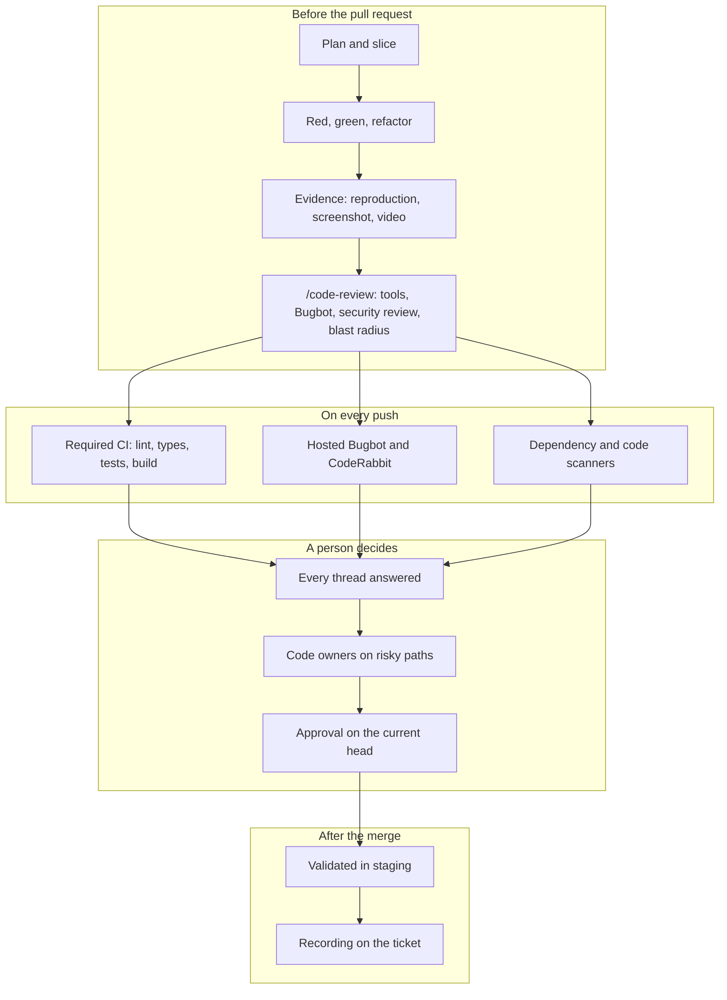

# How PlannerPal engineers work with coding agents

Agents write most of our code. So who checks it, and how do we know it works?

PlannerPal turns an adviser's client meeting into notes, documents and CRM updates. We do it in a regulated industry, for real firms, with a small team. A wrong write lands in someone's client file. That sets the bar, and the bar is the same whoever typed the code.

We did not remove review when agents arrived. We moved most of the reading to tools and models, kept people for the judgements only people can make, and made evidence a requirement instead of a courtesy. This is how that works, and what we expect from an engineer directing an agent.

The tools we name are the ones we use today: Cursor, Claude Code, Codex, Bugbot, CodeRabbit, Aikido, Trivy and GitHub Actions. The practice does not depend on any of them.

## Contents

* The short version
* What review is for
* The life of a change
* Layer by layer
* Answering a finding
* When the hosted bots find what we missed
* Review has to converge
* Before you write code
* Test-driven development with an agent
* Several pieces of work at once
* Definition of done
* Data boundaries
* How agents are steered
* How the stack gets better
* Where people stay in the loop
* Levels
* What we look for when hiring
* Anti-patterns
* Reading

## The short version

1. **Draft a rough spec, then let the agent find the gaps.** Have it interview you one question at a time, and have it read the code rather than ask you what the code already says. Take the questions it raises to the product owner.
2. **Slice the work before you start.** Half a day per agent and one pull request per slice. A ticket bigger than a few slices gets split. Call out hidden scope in writing before the first prompt.
3. **Run several pieces of work at once.** One agent, one branch, one pull request per task, each in its own worktree. Spend agent runtime on the next task, not on watching the cursor.
4. **Test first.** One failing test, then the smallest code that passes it. Never a test that stubs the thing it claims to test, and never one that pins the bug to go green.
5. **Prove it with evidence.** A reproduction before and after, a screenshot from each agent, a video on the pull request, your new test found by name in the CI log. If you cannot explain what the change does and why, it is not ready.
6. **Run `/code-review` before you open the pull request, then wait for Bugbot and CodeRabbit after you push.** Answer every finding.
7. **Keep the agent out of production, customer data and shared history.** It never merges, force-pushes, deletes a tag or reads a production secret. You press those buttons.
8. **Stop an agent that does something unfit.** Personal data in a payload, a bypassed contract, a delete to tidy up, a configuration change to make local work, quiet scope creep.
9. **Keep diffs small and matched to the repo.** A related problem you notice gets fixed in this pull request. An unrelated one gets its own pull request. A large one gets a ticket.
10. **When the agent gets something wrong, fix the rule, not the chat.** A lesson the next agent must follow goes in a skill, a rule or `AGENTS.md`.

## What review is for

Code review does two jobs. It finds problems before they ship, and it spreads understanding of the code across the team. Agents changed the economics of the first job most.

"Did a person read every line?" is a poor proxy for safety. The better question is: what could go wrong with this change, and which check, automated or human, is the right one to catch it? Lint does not get tired. A scanner does not skim. A model reads a thousand-line diff in a minute. None of them can tell you whether the feature should exist, whether the write lands on the right adviser, or whether the agent quietly widened the task.

So review no longer waits at the end of the road. It runs while the work happens. By the time a colleague is asked to look, the change has been through the deterministic tools, at least one Bugbot pass and a security walk, and the author has a recording of it working. People spend their attention on what is left.

Human attention is the scarce resource, on both sides of the ledger: the time we spend reviewing, and the time we spend cleaning up what slipped through. Saving the first by spending the second is not a saving.

## The life of a change

A change goes through several layers. Each catches some problems and misses others. Few get through all of them.



*Figure 1. Most of the path is automated. A person's attention goes where the risk is.*

## Layer by layer

### 1. The agent verifies its own work

Most review happens before a pull request exists. We give the agent something it can run, a test, a build, the real app in a browser, and ask it to show the output instead of saying it is done.

That starts with the test. The agent writes one failing test for the next behaviour and stops until a person approves it. The test is the specification, and rejecting a bad test is much cheaper than rejecting the code written to satisfy it.

It ends with evidence a reviewer can watch. A bug fix shows the bug before and not after. A visible change gets a short recording of the real local app, attached to the pull request. When five agents are running, each hands back a screenshot of its result, which is how you check five results in the time it takes to click through one, and how you catch the agent that reported done on a screen that renders blank.

### 2. `/code-review` before the pull request

Every pull request goes through the same local review before it is opened. Our `/code-review` skill orchestrates it, in a clean agent rather than the session that wrote the code.

**Tools first.** Lint, type-check, unit tests for the touched package, a secrets scan and the dependency scanner. Deterministic tools run before any model because they are faster and they do not hallucinate. The report names each tool and whether it ran. A tool that did not run is not a tool that passed.

**Then Bugbot.** One pass over the branch diff. The author fixes the serious findings and runs it again, up to three passes. Bugbot catches bugs; it does not review design. Its best classes for us are logic defects, races between concurrent jobs, weaker validation on a new path, authorisation drift, swallowed errors and missing owner checks.

**Then a security walk.** The OWASP web Top 10, and the LLM Top 10 when the diff touches prompts or model calls. It includes ordinary-use wrong writes: a signed-in user does the normal thing and the write lands on the wrong person or firm. People catch that class more often than bots do.

**Then blast radius.** What else could the change touch: API routes, events, schema, shared types, configuration, feature flags, other services? Does it only work if something else deploys first? Do the tests prove public behaviour, or spy on internals? Does the diff size match the stated goal?

The review ends in a one-line verdict: approve, approve with nits, or request changes.

### 3. Bugbot and CodeRabbit on every push

Opening the pull request is not done. The hosted Bugbot and CodeRabbit both review every push, minutes after it lands. An agent that answers the existing threads and ends its turn will miss the new ones, so it waits until both bots have reviewed the current commit and every new thread is answered.

We run two hosted reviewers on purpose. They are different products with different blind spots. Neither is a reviewer in the full sense. Both are bug catchers.

### 4. Scanners and CI that block

Required CI runs lint, types, tests and the build. Dependency and code scanners run on the pull request and again when the image is built, because new vulnerabilities land between the two. A green check is not proof that your test ran, so when you add one, find it by name in the CI log.

### 5. A person, where the risk is

A merge needs every required check green, every conversation resolved, and an approval from someone other than the author. Code your own agent wrote counts as yours. Paths with cross-tenant risk have code owners. A push after approval needs a fresh one, because an approval covers the commit it was given on. A bot's review never stands in for a person.

### 6. After the merge

The change is checked in staging, and a recording of it working there goes on the ticket, with a plain paragraph on the root cause and the fix so whoever retests knows what to retest.

## Answering a finding

Every finding is answered on its thread, in one of four ways.

* **Fixed,** with the commit.
* **False positive,** with the data-flow proof. *This value comes from the command line, not a request.*
* **Pre-existing,** with a ticket. The line is identical on the target branch and the fix is tracked separately.
* **Declined,** with the reason. *A stronger invariant already exists in the same file.*

A disputed finding stays open with the explanation, so the human reviewer sees both sides.

## When the hosted bots find what we missed

Every pull request has already been through `/code-review` when the hosted bots see it. So a real finding from Bugbot or CodeRabbit on that diff is more than a bug to fix. It is an escape: something our own review should have caught.

We treat that as a gap in `/code-review`, not only as a bug in the pull request. The fix is a lint rule, a line in the skill, or a wider search for callers, so the next local review catches it.

## Review has to converge

An agent author and an agent reviewer can keep each other busy indefinitely. Each fix spawns a new finding, the agent patches it, the bot finds the next one. We cap the local loop at three passes. When the bots keep finding things, stop and make the agent think: fix the whole class of bug in one pass, and re-review only the new diff. If the diff is large, the fix is a smaller diff, not a longer loop.

Noise costs more when the author is an agent. A person waves off a nit in seconds. An agent fixes it, which means another commit and another round.

For the final read we use a model from a different vendor, because two models from one vendor share blind spots. On high-risk work we run three and compare. The cost is reconciling their disagreements, and it is still cheaper than the bugs.

## Before you write code

**Call out scope.** The most expensive thing we deal with is a ticket that says "a small piece of work" and turns out to contain a new auth flow. If the scope is bigger than the ticket, say so in writing before any code. A design generated by an agent is not a ticket; it says what the screen looks like, not what the system does.

**Rule the flags in or out.** When something "doesn't work", the first ten minutes go on feature flags, not on the code path.

**Find every caller.** Before changing a method other screens or services call, search every repo, not just the file you are editing. If any caller would see a different result, stop and ask.

**Grill the plan.** For anything non-trivial, the agent interviews you about the plan before it writes a diff, one question at a time, reading the code instead of asking when it can. A running prototype beats a written spec; point the agent at it.

**Spike or TDD.** A known problem gets strict TDD. An unknown one gets a spike, written up and thrown away, then rebuilt through TDD. Do not mix them in one task.

**Slice it.** Cut the ticket into slices one agent can finish in about half a day, each a thin path through the stack ending in its own pull request. When a slice grows halfway through, stop and re-slice.

## Test-driven development with an agent

```text
RED       Write one test for the next behaviour. Run it. It fails for the right reason.
GREEN     Write the minimal code to pass. Run it. It passes.
REFACTOR  Clean up with everything green. Run again.
```

One test at a time, in vertical slices, so there is always a thin working path. When behaviour changes, prefer turning an existing test red to adding a new one.

A test earns its place if it would fail when the code is wrong. It tests behaviour through a public interface. It mocks only at system boundaries, never the thing it claims to verify. It would fail under mutation. It does not test the framework. It does not lock in today's bug. And it actually runs in CI.

End to end means a browser, driven the way a person would drive it.

## Several pieces of work at once

This is the practice that most changes how we work.

An agent on one task leaves you idle for minutes at a time. Agent speed only becomes team speed when you run several pieces of work alongside each other and spend your time reading results.

**One branch per task, one pull request per task.** **Isolate each agent** in its own worktree, clone or container. **Pin the checkout** for any investigation to one commit. **See the collisions coming** on shared files, migrations, ports and the dev database, and decide the merge order up front. **Read every result before it merges**: the data boundary, the auth path, the contract with callers, anything the agent chose that you did not ask for. If you cannot say what an agent changed, it does not merge.

Five pull requests, none understood and two broken, is worse than two done properly. Volume without reading is not throughput.

## Definition of done

Green CI is the floor, not the definition. Before you say done, the relevant checks have run for every stack you touched, your new test appears by name in the CI log, the scanners are clean, and the evidence is attached. Say what you verified and what you only read. "This is from reading the code; nothing was run" is a legitimate finding. Presenting it as tested is not.

A pull request that says "tested locally" with nothing attached has not been tested as far as the reviewer can tell. A screenshot of a design file is not evidence. The product, running, with seed data, is.

## Data boundaries

Agents never touch production credentials, customer data, dumps or production logs. They work against fixtures, fakes and seed data. Where we integrate with a third-party system we run a local fake of it, and the fake is changed to match the application, never the other way round.

Writes take their tenant from the authenticated context, never from the client. A database filter fed by a request is treated as hostile. Dependency findings are bumped when a fix exists, and tracked with a review date when it does not.

## How agents are steered

Everything an agent is told lives in the repo and goes through pull request review, like code.

| Layer | How it behaves | What we use it for |
| --- | --- | --- |
| `AGENTS.md` | Read first, every time | Orientation, which doc for which job, what never to do |
| Rules | Always on. Slim | Hard stops the agent cannot skip |
| Skills | Loaded by name or trigger | Playbooks: TDD, planning, code review, security review, dependency bumps, retros |
| Hooks | Run on agent edits | Nudges. They observe and do not block |

Hard stops live in rules, because an agent can skip a skill but not a rule. Skills stay short; one that reads like a contract does not get followed. When an agent repeats the same mistake, the fix is a line in the skill, not another telling-off.

There is very little magic in the prompt. The method lives in the rules and skills. The prompt is intent, and the skill is expressing intent clearly and then checking it was delivered.

## How the stack gets better

After a pull request is created or pushed, the agent offers a retro. It reviews the session, what went well, what went wrong, what it was told and ignored, and proposes edits to skills, rules and docs. Nothing changes until the engineer picks which edits to apply. A finding from Bugbot or CodeRabbit that the local review should have caught is the richest input.

## Where people stay in the loop

Pulling an engineer out of deep work to catch a routine mistake costs far more than a tool doing it. People remain responsible for:

* **Whether to build it.** Direction, taste, scope, and the hidden scope in a "small" ticket.
* **The data boundary.** Whose record this write lands on.
* **Risky paths.** Auth, tenancy, CRM writes, model prompts, and anything with a code owner.
* **Architecture that others will copy.**
* **Reading the evidence.** If you cannot say what the checks would miss, ask for a real review rather than a quick approval.
* **Owning the outcome.** A person is accountable for every change that ships, whoever typed it.

## Levels

| Level | What it looks like |
| --- | --- |
| Foundational | Reads code, tests and docs before prompting. Self-reviews and checks agent output before opening a pull request. |
| Working | Breaks work into thin end-to-end slices with checkpoints and fast feedback. Pull requests pass review first or second time. |
| Independent | Chooses well between close supervision and lower-supervision agent work. Uses TDD, small pull requests and git discipline. Carries several pieces of work at once. |
| Leading | Sets team standards for slicing, review quality and reusable agent workflows. |

The evidence is smaller pull requests, better first-pass review, fewer regressions and short-lived branches.

## What we look for when hiring

Our technical round is a 45-minute live pairing session on a small real codebase, with more tasks than one agent can finish in the time. Candidates bring their own tools. We are not scoring the tool. We are scoring:

* **Clarification.** Do they sketch the spec, use the agent to find its gaps, then ask us?
* **Plan.** Do they size each task and say which will ship? Does what landed match?
* **Throughput.** How many pieces of work are in flight, and is anything working in the browser at the end?
* **Isolation.** Is parallel work kept apart? Do they see the collisions coming on shared files, ports and the database?
* **Review per result.** Can they say what each agent changed and why? Did they check the evidence rather than read every line?
* **Unfit output.** Do they stop the agent when it leaks data, bypasses a contract, deletes to tidy up, or widens scope?

The bar is three or more tasks working, each on its own pull request, each verified. Serial work does not meet it, however good the single result. The first thing we ask once the agent finishes a piece of work is: what do you do now?

## Anti-patterns

* **AI fixing AI comments on a diff nobody understands.** The author owns the fix because the author has the context.
* **Declaring done while the hosted bots are still running.**
* **The Bugbot spiral.** Each fix spawns a new finding and the loop runs for days. Fix the class, and if the diff is large, split it.
* **Writing the whole spec by hand** when a rough draft and the agent's questions would get there faster.
* **One context window for everything.** It caps you at one task.
* **Accepting what you cannot explain.** If you could not explain it to a colleague, you cannot review it.
* **Accepting drift.** The agent's output is not the spec.
* **Hidden scope.** "Seven small UI tweaks" that contained a new auth flow.
* **One pull request that keeps growing.**
* **Patching the app to suit a fake or a local setup.**
* **The wrong checkout.** An investigation against a folder that is behind gives a confident wrong answer.
* **Stubbing the thing under test.**
* **Green CI that ran nothing.**
* **"The middleware handles it,"** with no test that fails when the fix is removed.
* **The agent merged it,** or deleted a tag, or force-pushed.
* **Long always-on rules.** They get ignored.

## Reading

* Matt Pocock, AI Hero, on tracer bullets, TDD, human-in-the-loop work and subagents
* Simon Willison, Agentic Engineering Patterns
* Addy Osmani, Morgan Westlee Lunt and Qing Wang, [How the Claude Code team does code review](https://claude.dev/blog/solving-code-review-at-anthropic/)
* OWASP Top 10, and OWASP Top 10 for LLM Applications
* Kent Beck, Test-Driven Development by Example

## About this document

It reflects practice at PlannerPal as of November 2026 and changes when the practice does. Questions are welcome as issues on this repo.
