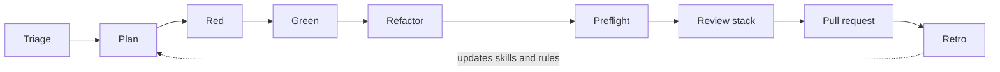

# Agentic engineering at PlannerPal

How we build software with AI coding agents.

PlannerPal turns an adviser's meeting into notes, documents and CRM updates, in a regulated industry, for real customers, with a small team. Agents write most of our code. The bar is the same whoever wrote it.

This document is for our engineers, for people thinking about joining, and for anyone who wants to see how a small team runs agents without lowering its standards. It describes what we do today. Where a practice is aspirational we say so.

The tooling we name is what we use now: Cursor, Claude Code, Bugbot, CodeRabbit, Aikido, Trivy, GitHub Actions. None of the practices depend on a particular tool.

## Contents

- [Principles](#principles)
- [The loop](#the-loop)
- [Before you write code](#before-you-write-code)
- [Test-driven development with an agent](#test-driven-development-with-an-agent)
- [Several pieces of work at once](#several-pieces-of-work-at-once)
- [Definition of done](#definition-of-done)
- [The review stack](#the-review-stack)
- [Security and data boundaries](#security-and-data-boundaries)
- [Git and pull requests](#git-and-pull-requests)
- [How agents are steered](#how-agents-are-steered)
- [The learning loop](#the-learning-loop)
- [Autonomous agents](#autonomous-agents)
- [Levels](#levels)
- [What we look for when hiring](#what-we-look-for-when-hiring)
- [Anti-patterns](#anti-patterns)
- [Reading](#reading)

## Principles

1. **The bar does not move.** An agent-written change is held to the same tests, review and security standard as a hand-written one. "The agent did it" is never a reason.
2. **The engineer is accountable for every line.** You read every diff before it merges. If you cannot explain what an agent changed and why, it is not ready.
3. **Throughput comes from carrying several pieces of work at once,** not from typing faster or prompting harder. Agent runtime is your idle time. Use it.
4. **Tests are how an agent proves its work.** Red, green, refactor. A failing test first, then the smallest code that passes it.
5. **Deterministic tools before models.** Lint, type-check, tests and scanners run before a model reviews anything. They are faster and they do not hallucinate.
6. **Rules and skills are versioned like code.** What an agent is told lives in the repo, is reviewed in pull requests, and is updated from retros.
7. **Secrets, production and customer data are off limits to agents.** Fixtures, fakes and read-only restores instead.
8. **Small diffs, one task per branch, one pull request per task.** Match the patterns already in the repo. Do not refactor quirks you were not asked to touch.

## The loop

Every change, however small, goes round this loop.



| Step | What happens | Who decides |
|------|--------------|-------------|
| Triage | Rule feature flags in or out. Find every caller of anything shared you are about to change. | Engineer, with agent |
| Plan | Agree what is being built and what is not. One question at a time. Explore the code rather than ask. | Engineer and agent, then human sign-off |
| Red | Write or change one test so it fails for the right reason. | Agent writes, human approves the test |
| Green | Smallest code that passes. No speculation. | Agent |
| Refactor | Clean up with the test green. Never while red. | Agent, engineer reads |
| Preflight | Lint, type-check, tests for every stack touched. Trivy where the repo scans. | Agent runs, engineer reads |
| Review stack | Tools, then Bugbot, then a security review, then blast radius. | Agent orchestrates, engineer owns |
| Pull request | Small, one task, demo video for UI changes. CI, Bugbot, CodeRabbit, Aikido green. Every thread resolved. | Engineer |
| Retro | What went well, what went wrong, which rule or skill to change. | Engineer picks, agent applies |

## Before you write code

### Rule the flags in or out

When something "doesn't work" or a screen is missing, the first ten minutes go on feature flags, not on the code path. Our product flags are booleans resolved at login. Find the gate in code, check the stored value, re-login, and write down the verdict: flag explains it, or flags ruled out. Hours of debugging a gated path is the most common waste we see.

### Find every caller

Before changing a method that other screens or services already call, search every repo in the workspace, not just the file you are editing. Report the callers. If the default contract stays what callers get today, carry on. If any existing caller would see a different result, status or side effect, stop and ask. A unit test that stubs the database call only proves the query object the code built; the proof that callers are unaffected is an integration test against a real or in-memory store.

Auth, feature flags, API contracts and shared state carry a must-read gate before anything is changed.

### Grill the plan

For anything non-trivial, the agent interviews you about the plan before writing a diff. One question at a time. If a question can be answered by exploring the codebase, the agent explores instead of asking. The aim is a shared understanding of each branch of the decision tree: what is in, what is out, what we are not sure about. Large diffs do not start without that. The engineer agrees the plan and reviews the first tests before build starts.

### Spike or TDD

Pick the mode before writing code, and do not mix them in one task.

- **Known problem:** strict TDD. No production code without a failing test first.
- **Unknown problem:** spike first. Write the spike findings document before the code. Spike code lives in a quarantined folder, has no tests, and is never promoted. When the spike has answered the question, the real change is rewritten through TDD.

If in doubt, spike first.

### Size it

Before starting, say how big each piece of work is and which pieces will ship in the time you have. A plan at the end of the session is a miss. Working software, however small, is the point. This is also how we tell whether an engineer can judge difficulty, which matters more with agents, not less.

## Test-driven development with an agent

### The cycle

```
RED      Write one test for the next behaviour. Run it. It fails for the right reason.
GREEN    Write the minimal code to pass. Run it. It passes.
REFACTOR Clean up with everything green. Run again.
```

One test at a time. Do not write all the tests and then all the implementation; that is horizontal slicing and it hides design problems until the end. Work in vertical slices, tracer bullets through the whole stack, so there is always a thin working path.

### Halt after red

In our newer codebase the agent stops after writing the red test and waits for a human to approve it before writing any production code. The test is the specification. It is cheap to reject a bad test and expensive to reject the code written to satisfy it. This is an always-on rule, not a skill the agent can skip.

### Prefer turning an existing test red

When changing behaviour, change an existing test so it fails. Add a new test only when no current case would fail. This keeps the suite describing the system rather than accumulating one test per prompt.

### What counts as a test

A test earns its place if it would fail when the code is wrong. We check five things:

1. **It tests behaviour through a public interface,** not implementation detail.
2. **It mocks only at system boundaries:** network, clock, third-party APIs. Never your own classes or modules, and never the thing the test claims to verify. That is a tautology, not a test.
3. **It would fail under mutation.** If you flip the condition, does it go red?
4. **It is readable by a human and an agent.** `// Arrange`, `// Act`, `// Assert` comments make a test scannable for both.
5. **It does not test the framework.** No tests that a component mounts, that a schema introspects, that a class list is present, or that an ORM default applies.

Backend query behaviour is tested against an in-memory or containerised database. A unit test that stubs the collection or the query builder checks only the shape of the query, not whether it returns the right rows.

End-to-end tests behave like a human. A passing end-to-end suite should mean the product works for a person, not that the test could find its selectors.

### Coverage

We measure line coverage per repo and track it over time. We do not gate releases on a percentage yet; we need stable numbers first. Pull requests do not collect coverage, the integration branch does. A review flags deleted coverage and spy-only tests.

## Several pieces of work at once

This is the practice that most changes how we work, and the one we hire for.

### Why

An agent working on one task leaves you idle for minutes at a time. The backlog has many small things in it. The way to turn agent speed into team speed is to run several pieces of work alongside each other and spend your time reading results, not watching cursors.

### How

**One branch per task, one pull request per task.** Never let two tasks share a branch.

**Isolate each agent.** A git worktree, a second clone, a container, or a cloud agent on its own VM. The mechanism does not matter. What matters is that no agent is editing in a folder where you are switching branches, and no two agents share a working copy.

**Never `git stash` in a repo with several worktrees.** The stash is shared across them and you will pop someone else's work. To test against old code, swap the file in with `git show <base>:<file> > <file>` and copy it back after.

**Plan for collisions before you start.** Three tasks that each add a route will collide in the routing file. Two tasks that each add a migration will collide on the migration number. Two agents on one machine will collide on ports and on the dev database. Decide the merge order up front, run the shared-resource tasks in sequence, and renumber migrations rather than writing merge migrations.

**Read every result before merging it.** Each diff gets read. Each result gets checked in the browser or by its tests, independently of the others. If you cannot say what a particular agent changed, it does not merge.

**One base at a time.** When the same fix has to land on two bases, an integration branch and `main` for example, finish one first. Get that pull request green on CI and every bot with every thread resolved, then port the final diff. Opening both together means every review round is done twice.

**Stop an agent that does something unfit.** The things that have earned an immediate stop: writing personal data into a payload that does not need it, bypassing the module that owns a kind of write, deleting rows to tidy up, and quietly widening the scope of the task. The agent is fast; your judgement is the control.

### What good looks like

Three or more tasks working, each on its own pull request, run alongside each other, each diff read before it merged, collisions in the shared file resolved by hand, tests green on the integration branch afterwards.

Five agents, five pull requests, none of them read and two of them broken is a worse outcome than two tasks done properly. Volume without reading is not throughput.

## Definition of done

Green CI is the definition of quality.

- **Preflight before you say done.** Lint, type-check and the relevant tests for every stack you touched. Use affected-project tooling where the repo has it. Regenerate anything generated: GraphQL types, sync schemas.
- **Smallest relevant target first.** Run the one test file, then the package, then the suite only if you need independent confirmation of something CI has already shown.
- **Run checks sequentially,** not concurrently. Lint, then build, then test. Parallel runs on a shared or constrained host produce timeouts that look like failures.
- **Cap the run.** On a constrained host set a timeout, cap the Node heap, cap workers, and limit CPU affinity. If a required check cannot run safely under those caps, report the CI result and the local limitation. Do not retry without limits.
- **Check for leftovers.** After an interrupted or timed-out run, look for orphaned test or compiler processes.
- **Trivy exit code zero** before a pull request in any repo that scans. If it fails, do not open the pull request.
- **Documentation goes to its home.** Living behaviour is a specification. A choice is a thin decision record, under eighty lines, with no implementation steps in it. An unknown is a spike document. A build sequence is an editor plan and is not committed to the docs folder.

## The review stack

Every pull request goes through the same stack in the same order, in both of our main codebases. An agent orchestrates it; the engineer owns the result. It runs before `gh pr create`, not after.

### 1. Tools

Lint, type-check, unit tests for the touched packages, Trivy where configured, a secrets scan where the diff touches hooks or anything secrets-adjacent. These are deterministic and run first.

### 2. Bugbot

One Bugbot pass over the branch diff. When authoring a pull request, fix the Critical and High findings yourself and run it again. Maximum three passes. Bugbot is skipped only when the diff is docs, skills or editor rules alone, and then the report says `skipped — <reason>`. Findings are never invented to fill the section.

### 3. Security review

An OWASP walk: the web Top 10, and the LLM Top 10 when the diff touches prompts, model calls or anything that feeds a model. Think like an attacker. Prefer a failing test to a lecture. Never write exploit payloads or step-by-step abuse into the review.

One class gets its own line: ordinary-use wrong writes. A signed-in user does the normal thing and the write lands on the wrong person, tenant or session. It is not an injection and it is not an access-control bypass in the usual sense, and it is the one that hurts us most in a regulated product.

### 4. Blast radius

What else could this change touch: API routes, events, database schema, shared types, configuration, feature flags. Does the diff size match the stated goal? Do the tests prove public behaviour or spy on internals? Was any coverage deleted?

### On the pull request

CI, Bugbot, CodeRabbit and Aikido run on every pull request. All green, every thread resolved. Paths that carry cross-tenant risk have code owners, so a human who knows the risk reviews them. Two human approvals on the main codebases.

A second review model from a different vendor is used for some automated reviews. Two models from one vendor share blind spots.

## Security and data boundaries

### Secrets

Agents never read, print, summarise or copy `.env` files, private keys, credentials, service account files, dumps, production logs or customer exports. They use `.env.example`, fixtures, fakes and documented test defaults. If a task appears to need a secret, the agent stops and asks for a safer route. Agents do not change your git config.

### Production

No production credentials, databases or APIs without explicit approval of the exact action. Investigation tooling reads from a restore, read-only, through a gate that redacts. Live checkouts are never mounted into an autonomous agent.

### Multi-tenancy

Non-negotiable. Writes use the tenant from the authenticated context, never a client-supplied tenant ID. Every mutation has a trust-boundary test: send a mismatched tenant in the input, assert the row lands in the context tenant.

### Query injection

Any database filter whose value comes from a request, a token, a job or another document is treated as hostile.

- The fix is at the query site: a strict equality operator or a type check. Middleware is not proof.
- The proof is a test on an in-memory database that fails when the old query is swapped back in.
- The static rule that found it is run locally before and after the change.

An editor hook watches agent edits to JavaScript and TypeScript. When the new text contains a database filter with a bare identifier as its value, it tells the agent to read the injection skill. It observes only, never blocks, and fails open.

### Schema

Relational by default. An agent halts before adding a persisted JSON column and waits for a human to approve it.

### Dependencies

For each High or Critical scanner finding: if upstream has a fixed version, bump it. If not, add an ignore entry with a review-by date about six weeks out. Never add an ignore for a finding that has a fix. A bump needs unit tests of our code that uses the package, passing on the old pin and the new one. Never write a test that imports the package directly; if nothing of ours reaches a direct dependency, say it looks unused rather than opening a version-only pull request. Open the pull request from a branch we own, based on the scanned branch, never on a scanner's autofix branch.

### Fakes of third parties

Where we integrate with a third-party system we run a local fake of it. The fake matches what the application already sends and expects. The application is never patched to suit the fake. If the fake does not work against the app, the fake is wrong.

## Git and pull requests

- Branch from the integration branch, one task per branch, named for the task.
- Small diffs. Match the patterns already in the repo. Do not refactor quirks you were not asked to touch.
- Commit in the repo the code belongs to. Workspace docs and scripts commit in the workspace repo.
- Follow the repo's commit style. No AI attribution footers.
- Agents do not commit, push or open pull requests without being asked. Nobody pushes to `main` without permission.
- Signed commits.
- A UI change gets a short demo video of the real local UI attached to the pull request description, not committed to the repo.
- Never commit secrets or operational notes.

## How agents are steered

Everything an agent is told lives in the repo and goes through pull request review.

### Three layers

| Layer | Behaviour | Used for |
|-------|-----------|----------|
| `AGENTS.md` | Read first. Orientation, routing table, rules of thumb. | Which doc to read for which job; what never to do |
| Rules | Always-on or attached by file glob. Deterministic. Slim. | Halt constraints: TDD red, JSON column approval, API impact, the review stack pointer |
| Skills | Loaded on demand by name or by trigger. Probabilistic. | Step-by-step playbooks: TDD, grill-me, code review, security review, dependency bump, injection fix, retro |

Halt-style constraints stay in rules, because a skill can be skipped and a rule cannot. Fat rules were split into slim rules plus skills after we found long always-on text was being ignored.

Hooks observe. The one we run nudges on suspicious database filters; it does not block.

### Our skills

| Skill | When it runs |
|-------|--------------|
| `/feature-flags` | Before deep debugging; rule gated behaviour in or out in ten minutes |
| `/api-impact` | Before changing anything other screens or services already call |
| `/grill-me` | Before non-trivial work; one question at a time until the plan is shared |
| `/tdd` | During implementation; red, green, refactor, vertical slices |
| `/code-review` | Creating or reviewing a pull request; tools, Bugbot, security review, blast radius |
| `/security-review` | The OWASP walk on its own |
| `/nosql-injection` | Any filter fed by a request, token, job or document |
| `/dependency-bump` | Scanner findings and version pins |
| `/ci-preflight` | Definition of done for every stack touched |
| `/agentic-retro` | After a pull request is created or pushed, or after a multi-agent run |
| `/pr-demo` | Record the real UI and attach it to the pull request |
| `/sync-repos`, `/tidy-branches` | Keep a multi-repo workspace and its worktrees clean |

`grill-me` and `tdd` are vendored from [mattpocock/skills](https://github.com/mattpocock/skills) and refreshed by copying upstream. The rest are ours.

## The learning loop

After a pull request is created or pushed, the agent asks whether you want a retro. It does not start one until you say yes.

The retro reviews the session: what went well, what went wrong, what the agent was told that it ignored, what it was not told that it needed. It produces a table of proposed edits to skills, rules and docs. Nothing is edited until the engineer picks which rows to apply.

The rule is: a lesson the next agent must follow goes in a skill, a rule or `AGENTS.md`. It does not stay in a chat.

We also track, per repo, a quality matrix that scores test coverage, review gates and whether the repo's agent instructions match the workspace's, so the drift between what we say and what each repo enforces is visible.

## Autonomous agents

We run one autonomous agent, an investigator built on the Cursor SDK, that picks up bug tickets and error alerts. The rules it runs under are the ones we want for any agent working without a human watching.

- **Least privilege.** It works in an isolated worktree, never a live checkout. Data access is a read-only restore through a redacting gate. Cross-repo search runs on read-only snapshots.
- **Declared outcome.** Every report starts with one of `dead-end`, `data-evidence` or `smoking-gun`, and that tag decides where the report goes. No hedging prose.
- **Never the last step.** It publishes a branch. It never force-pushes and never opens a pull request. A human-run review must pass on the worktree before anything moves further.
- **No side effects unless asked.** It does not post to chat or the tracker unless the engineer running it says so.
- **A second vendor's model for review.** Its pull request review deliberately uses a different model family from the one that wrote the code.

## Levels

How we describe growth in agentic coding, from our engineering skills framework.

| Level | What it looks like |
|-------|--------------------|
| Foundational | Reads code, tests and docs before prompting. Writes clean code, self-reviews against the team's standards and skills, checks agent output before opening a pull request. |
| Working | Breaks work into thin end-to-end slices. Uses explicit prompts, checkpoints and fast feedback loops. Pull requests pass maintainability review first or second time. |
| Independent | Chooses well between human-in-the-loop and lower-supervision agent work. Uses tracer bullets, TDD, small pull requests and git discipline to ship reliable changes. Carries several pieces of work at once. |
| Leading | Sets team standards for prompting, slicing, review quality and reusable agent workflows. Same-day integration where practical. |

Evidence: smaller pull requests, better first-pass review, fewer regressions, short-lived branches.

## What we look for when hiring

Our technical round is a 45-minute live pairing session on a small real codebase, with more tasks than one agent can do in the time. Candidates use their own tools. We are not scoring which tool or mechanism they use. We are scoring:

- **Clarification.** Do they use the agent to work out what to ask, then ask us, rather than hand-writing a specification or guessing.
- **Plan.** Do they size each task and say which ones they will ship before they start. Does what landed match the plan.
- **Throughput.** How many pieces of work are in flight. Is anything working in the browser at the end.
- **Kept apart.** Is parallel work isolated. Do they switch branches under a running agent. Do they see the collisions coming on shared files, ports and the database.
- **Review per result.** Did they read each diff before merging. Can they say what each agent changed.
- **Unfit output.** Do they stop the agent when it leaks data, bypasses a contract, deletes to tidy up, or widens scope.
- **Energy.** A working path at the end, not a plan.

The bar is three or more tasks working, each on its own pull request, run alongside each other, each diff read. Serial work, one task at a time all the way through, does not meet it however good the single result.

## Anti-patterns

Things we have seen go wrong and now name.

- **Hand-writing the spec.** Twenty minutes typing a requirements list before the first prompt, when the agent would have drafted the questions in one.
- **One context window for everything.** Wanting one context to hold it all is a preference for serial work. It caps throughput at one task.
- **Accepting what you don't understand.** Taking a locking strategy from an agent you could not explain to a colleague. If you cannot explain it, you cannot review it.
- **Accepting drift.** One duration agreed, another delivered, "we're aware of that". The agent's output is not the spec.
- **A plan at the end.** An hour of planning and nothing in the browser.
- **Volume without reading.** Many pull requests, none read, some broken.
- **Patching the app to suit the fake.** The fake is wrong, not the application.
- **Stubbing the thing under test.** A green test that proves the query object was built is not a test of the query.
- **"The middleware handles it".** Not without a test on a real store that fails when the fix is removed.
- **Long always-on rules.** They get ignored. Slim rules for halts, skills for playbooks.
- **Both bases at once.** Two pull requests for one fix means two of every review round.
- **`git stash` across worktrees.** You will pop someone else's work.

## Reading

- [Matt Pocock, AI Hero](https://www.aihero.dev/) on tracer bullets, TDD, human-in-the-loop and subagents, and the [skills](https://github.com/mattpocock/skills) we vendor
- [Simon Willison, Agentic Engineering Patterns](https://simonwillison.net/guides/agentic-engineering-patterns/) on git, testing and anti-patterns with coding agents
- [OWASP Top 10](https://owasp.org/www-project-top-ten/) and [OWASP Top 10 for LLM Applications](https://genai.owasp.org/)
- [Kent Beck, Test-Driven Development by Example](https://www.oreilly.com/library/view/test-driven-development/0321146530/)

## About this document

It reflects practice at PlannerPal as of November 2026 and is updated when the practice changes. Corrections and questions are welcome as issues on this repo.
